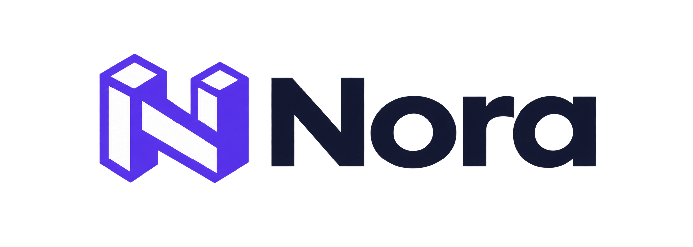

<p align="center">
  
</p>

# Nora Framework

Nora is an independent, modular PHP framework created in Morocco by
**Morave Technologies**, its project origin and maintainer. The project aims
to serve Moroccan and international PHP developers through a small, explicit
core, practical tooling, security-conscious defaults, and carefully designed
optional integrations.

Nora has its own framework core and public APIs; Laravel and Symfony are not
underlying runtime frameworks or dependencies. It uses Composer and established
PHP conventions where appropriate. Nora is early-stage software, not a
production-certified release. The project does not claim to be Morocco's first
PHP framework; see the [scoped project comparison](docs/PROJECT_POSITIONING.md).

Nora Framework's code is distributed under the [MIT License](LICENSE).
The copyright holder's name in the license notice still needs maintainer
confirmation; Morave Technologies is identified as the project origin and
maintainer, which does not by itself establish the legal copyright holder.
See [trademark guidance](TRADEMARKS.md) for the separate use of Nora's name,
logos, and branding.

## Project authority and community participation

The project designates [`Yasser-devb/nora`](https://github.com/Yasser-devb/nora)
as the official Nora repository. Morave Technologies is identified as the
project origin and maintainer. Community members may discuss proposals and
submit changes through forks and pull requests under the
[contribution guidance](CONTRIBUTING.md). A proposal is not an accepted Nora
change until an authorized maintainer reviews and merges it.

Repository administration, branch permissions, and release publication remain
with the authorized maintainer. Only releases published by the maintainer from
the official repository are official Nora releases. This policy does not stop
third parties from publishing modified forks when the applicable license
permits it; forks must not imply endorsement or official status. See
[contribution guidance](CONTRIBUTING.md),
[release policy](RELEASE_POLICY.md), and
[trademark guidance](TRADEMARKS.md).

The MIT license applies to the covered code and does not transfer copyright
ownership. No CLA or copyright assignment is introduced.

## Requirements and installation

- PHP 8.2+ (the current CI matrix tests PHP 8.2 and 8.3)
- Composer 2
- `PDO` and `pdo_mysql` for the supported MySQL/MariaDB database baseline

The Composer package is named `morave/nora` in the repository metadata and
the code is licensed under [MIT](LICENSE). Packagist currently does not return
a published package for that name, so `composer require morave/nora` is **not
yet a verified public installation path**. The intended command after a
release has been published and verified on Packagist is:

```powershell
composer require morave/nora
```

For source checkout testing only, an authorized user can configure Composer
to use the Git repository directly:

```powershell
composer config repositories.nora vcs https://github.com/Yasser-devb/nora.git
composer require morave/nora:dev-main
```

This installs the current development branch, not a stable Packagist release.
The MIT license terms apply; see [LICENSE](LICENSE).

The package maps `Nora\` to `src/` and registers `bin/nora` as a Composer
binary. A consuming project can bootstrap the framework with its own
`vendor/autoload.php`:

```php
<?php

require dirname(__DIR__) . '/vendor/autoload.php';

use Nora\Core\ApplicationBootstrap;

(new ApplicationBootstrap())->boot(dirname(__DIR__))->run();
```

The application root may contain `routes.php` or `src/routes.php`,
`config/app.php`, environment-specific config, and an optional `.env`.
`ApplicationBootstrap` registers the route file and returns the application;
`run()` creates the request from PHP globals and sends the response.

Package archive exclusions omit tests, examples, the editor extension, local
environment files, and development-only tooling while retaining framework
source, the CLI, runtime assets, documentation, and `.env.example`. See the
[Packagist release checklist](docs/PACKAGE_RELEASE.md) for the distinction
between source checkout installation and a future public package release.

```powershell
composer install
composer validate --strict
composer audit
composer test -- --display-warnings
```

The root [.env.example](.env.example) contains names and safe defaults only.
Copy it to `.env` for local work; never commit secrets.

## Create and run an application

```powershell
php bin\nora new my-app
cd my-app
composer install
copy .env.example .env
php ..\bin\nora serve
```

`nora new` creates a project using a Composer path repository pointing to the
Nora checkout that generated it. That repository path is machine-specific;
change it before sharing the generated project. The PHP built-in server is for
development only.

The generated `public/index.php` uses `ApplicationBootstrap`, which loads
`.env`, merges `config/app.php`, `config/{APP_ENV}.php`, and process environment
values, validates core settings, registers `routes.php` or `src/routes.php`,
and runs the HTTP lifecycle. Process environment values take precedence over
`.env`; environment-specific PHP config overrides base config; explicit
environment values override both. A route registration closure can read the
validated config through `$app->config()`.

## Nora's website example

The project website exists as a real Nora application in
[examples/nora-website](examples/nora-website/README.md). Its homepage
demonstrates a server-rendered reactive counter, and the application exercises
Nora's routing, escaped templates, HTTP responses, and safe 404/error
handling. The reactive API is experimental; the website is a local example,
not a deployed public site or a production-readiness claim.

The config files return arrays, for example:

```php
<?php

return [
    'app' => [
        'environment' => 'development',
        'debug' => true,
    ],
    'logging' => [
        'level' => 'debug',
    ],
];
```

Supported log levels are `debug`, `info`, `notice`, `warning`, `error`, and
`critical`; `NORA_LOG_LEVEL` can override `logging.level`.

## HTTP and routing

```php
use Nora\Core\Application;
use Nora\Http\Request;
use Nora\Http\Response;

$app = new Application();
$app->route('GET', '/users/{id}', static function (Request $request, array $parameters): Response {
    return Response::json(['id' => $parameters['id']]);
});
$response = $app->handle(Request::fromUri('GET', '/users/42'));
```

Route handlers receive a `Request` and named path parameters and return a
`Response`. Routes are matched in registration order. Register literal paths
before overlapping parameterized paths. Middleware implementing
`Nora\Routing\MiddlewareInterface` is applied in registration order.
`Application::run()` creates a request from PHP server variables and sends the
returned response.

Follow the [first application tutorial](docs/tutorials/FIRST_APPLICATION.md)
for a scaffolded app and end-to-end request example.

## Configuration and logging

`Nora\Config\EnvironmentLoader` loads simple `KEY=value` assignments without
interpolation or command execution. Existing process environment variables
win by default. `Nora\Config\Config` supports layered arrays, dot-path lookup,
required values, and type validation.

`ApplicationBootstrap` defaults to production mode and debug off. Set
`APP_DEBUG=true` only in development. `Nora\Logging\StructuredLogger` writes
JSON-lines records; sensitive context keys, credential-like text, and objects
are redacted or omitted. `ExceptionHandler` maps `HttpException` status codes,
logs failures, and avoids exposing internal details in production responses.

## Dependency injection

The container supports explicit bindings, transient/singleton lifetimes,
constructor injection for concrete classes, and circular dependency detection.
Do not pass untrusted class names to it.

```php
use Nora\Container\Container;

$container = new Container();
$container->singleton(
    'clock',
    static fn (Container $container): object => new DateTimeImmutable()
);
$clock = $container->get('clock');
```

## Validation and views

`Nora\Validation\Validator` accepts nested data and rules such as
`required|string|min:2|max:80`, `integer`, `boolean`, and `email`. Custom rules
implement `ValidationRuleInterface`; validation is not authorization or output
encoding.

`Nora\View\TemplateRenderer` reads plain `.nora` templates. `{{ user.name }}`
values are escaped with `htmlspecialchars`; ``
reuses templates under the configured template root. PHP is never evaluated,
and there is no raw/unescaped interpolation syntax.

## Reactive UI prototype

`php bin\nora new my-app` now creates a server-rendered reactive counter
example. It has two adjacent keyed display sections rendered from one
server-owned page count and a field that demonstrates input preservation.
These sections are template partials, not independently stateful nested
reactive components. The generated application serves Nora's first-party
browser runtime automatically; the developer does not register JavaScript or
mount UI islands.

The prototype uses the `Nora\Reactive\ReactiveComponent` and
`Nora\Reactive\ReactiveAction` APIs. Actions are explicitly registered,
arguments are validated, page state is stored in the PHP session, and requests
require a CSRF token and current page revision. Protected actions must define
their own authorization callback; missing authorization policies deny by
default. Actions intentionally public to a valid page holder must use
`ReactiveAction::publicAction(...)`. The runtime applies server-rendered
updates without a full-page navigation, using keyed DOM reconciliation.

This is an experimental, early vertical slice—not a stable API or a production
readiness claim. The generated counter denies increments once its count reaches
10 as a demonstration of action authorization; real applications must define
their own authorization policies. It does not provide reactive forms,
independent nested component state or cross-component state ownership,
navigation/history, offline support, automatic retries, uploads, or persistent
real-time transport. Component `render()` output is trusted PHP-authored
markup; escape dynamic data with `TemplateRenderer`.
Read the [reactive engine specification](architecture/REACTIVE_UI_ENGINE.md)
for the security model and implemented/planned boundary. The local Chromium test covers the generated page, runtime load, allowed and
rejected actions, no-navigation updates, and preservation of compatible input
values, focus, and selection. See the [implementation status](docs/audit/IMPLEMENTATION_STATUS.md)
for exact verification results and unverified areas.

Run the browser integration test after installing the Node development
dependencies and Chromium:

```powershell
npm ci
npm audit
npx playwright install chromium
npm run test:browser
```

## Database

```php
use Nora\Database\PdoConnection;
use Nora\Database\QueryBuilder;

$db = PdoConnection::connect(
    getenv('NORA_DSN'),
    getenv('NORA_DB_USERNAME') ?: null,
    getenv('NORA_DB_PASSWORD') ?: null,
);
$rows = $db->select(
    QueryBuilder::select('users', ['id', 'email'])->where('active', '=', 1)->limit(50)
)->fetchAll();
```

Values use prepared statements. Identifiers and operators in `QueryBuilder`
are allowlisted; the builder currently supports SELECT queries. `PdoConnection`
provides transaction, fetch, and execute helpers. Migrations return a
`MigrationInterface` from files named `YYYY_description.php`; `migrate` and
`migrate:status` require `NORA_DSN`. MySQL DDL may auto-commit, so a migration
that fails after DDL can require manual repair. PDO unit tests use test
doubles; live MySQL/MariaDB integration requires a dedicated test database and
the `NORA_TEST_DSN`, `NORA_TEST_DB_USERNAME`, and `NORA_TEST_DB_PASSWORD`
variables. The current environment has `pdo_mysql` enabled but no local server
on port 3306, so live integration remains unverified. Setup instructions and
the test's non-destructive scope are in the
[implementation status](docs/audit/IMPLEMENTATION_STATUS.md).

## Sessions and security

`SessionMiddleware` starts and closes the native session around a request;
register it before `CsrfMiddleware` on browser/session-backed routes.
`SessionManager` uses PHP sessions with strict mode, cookie-only transport,
HTTP-only, SameSite=Lax cookies, and secure cookies by default. `SessionAuthenticator`
regenerates the session ID on login/logout and delegates user lookup to an
application callback. It also invalidates the session CSRF token on
authentication transitions. `PasswordHasher` wraps PHP's password APIs. For
local HTTP-only development, explicitly configure `new SessionManager(false)`;
keep secure cookies enabled in production.

`Gate` denies unknown abilities. Apply it in handlers/middleware for
authorization. `CsrfMiddleware` protects unsafe methods when explicitly
registered for browser/session-backed routes; it accepts `X-CSRF-Token` or a
form `_csrf` field. Do not apply browser CSRF assumptions indiscriminately to
stateless APIs. Authentication providers, rate limiting, file-upload
protection, and a complete account lifecycle are not included.

## CLI

```powershell
php bin\nora --help
php bin\nora --version
php bin\nora make:controller User
php bin\nora make:model User
php bin\nora migrate:status
php bin\nora migrate
```

Generators validate names and refuse to overwrite files. `serve` starts PHP's
development server. Database commands require an explicitly configured DSN;
they fail rather than claim migrations succeeded when the database is
unavailable.

## Tests and status

`composer test` runs unit, integration, and security suites. The Playwright
browser test separately exercises a clean generated app and its reactive
round-trip. CI runs Composer validation, PHP syntax checks, the PHP suite on
PHP 8.2 and 8.3, and a Chromium reactive-browser job. Static analysis,
benchmarks, production web-server recipes, and routine real database
integration tests are not yet configured or verified. See the transparent
[implementation status](docs/audit/IMPLEMENTATION_STATUS.md) and
[roadmap](docs/ROADMAP.md).

Implemented and tested in this repository: request/response dispatch,
bootstrap and configuration, DI, middleware, exception handling/logging,
validation, PDO query binding and migration tracking logic, CLI generation and
commands, session/authentication integration, authorization, CSRF, and
escaped template rendering.

Still incomplete or unverified: production-grade reactive forms, independent
nested component state, navigation and robust recovery; real MySQL/MariaDB
connection/migration runs, rate limiting, full authentication/account
workflows, file uploads, controller
dispatch conventions, route groups/URL generation, production deployment,
independent security review, performance benchmarks, and optional AI
integration. Do not treat passing tests as a security certification.

## Project, governance, and documentation

- [Nora Template VS Code extension](extensions/vscode-nora/README.md) —
  local development and VSIX instructions; Marketplace publication is not
  verified.
- [Project positioning and scoped comparison](docs/PROJECT_POSITIONING.md)
- [Roadmap](docs/ROADMAP.md)
- [First application tutorial](docs/tutorials/FIRST_APPLICATION.md)
- [API reference](docs/API_REFERENCE.md)
- [Architecture overview and diagrams](architecture/SYSTEM_OVERVIEW.md)
- [Reactive UI engine specification](architecture/REACTIVE_UI_ENGINE.md)
- [Security architecture](architecture/SECURITY_ARCHITECTURE.md)
- [Contribution policy](CONTRIBUTING.md)
- [Release policy and recommended GitHub protections](RELEASE_POLICY.md)
- [Name and branding guidance](TRADEMARKS.md)
- [Security reporting policy](SECURITY.md)

The public GitHub repository metadata currently reports `main` as the default
branch. Branch/tag protection, required reviews/checks, and repository
permissions have not been verified. See the [implementation status](docs/audit/IMPLEMENTATION_STATUS.md)
for local versus hosted validation status.
- [Contributing](CONTRIBUTING.md), [Code of Conduct](CODE_OF_CONDUCT.md),
  [Security Policy](SECURITY.md), and [Release Policy](RELEASE_POLICY.md)

Documentation is maintained in English. French and Arabic translations are
planned, not yet available. Public issue templates and a pull-request template
are provided. Before a stable public release, the maintainer must confirm the
legal rights-holder name in [LICENSE](LICENSE), review contribution terms,
and verify a monitored private vulnerability-reporting channel.
