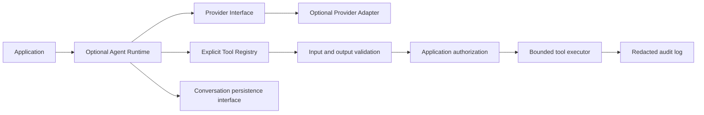

# AI Agent Integration Architecture

## Status: Planned, not implemented

Nora is independent of AI providers. It currently has no agent runtime, provider adapter, conversation storage,
retrieval system, tool registry, or AI dependency. Provider-specific code must
remain optional and outside the required framework core.

The model must not receive ambient filesystem, shell, network, database, or
administrative access. Each future tool must declare an identifier,
description, input/output schema, permissions, read/mutate classification,
timeout/resource bounds, and audit behavior. Sensitive operations require
application authorization. External content and model output are untrusted;
prompt instructions alone are not a security boundary.

## Required contracts and tests before implementation

Plan provider-neutral request/response and capability contracts, conversation
isolation and retention, tool registry/execution, cancellation/timeouts, usage
metering, and optional background jobs. Deterministic tests must cover invalid
arguments, denied authorization, prompt injection, malicious retrieved
content, timeouts, provider failures, repeated tool calls, redaction, tenant
isolation, and retrieval access control.

No provider or autonomous agent capability is claimed until it has concrete
implementation and passing tests.
