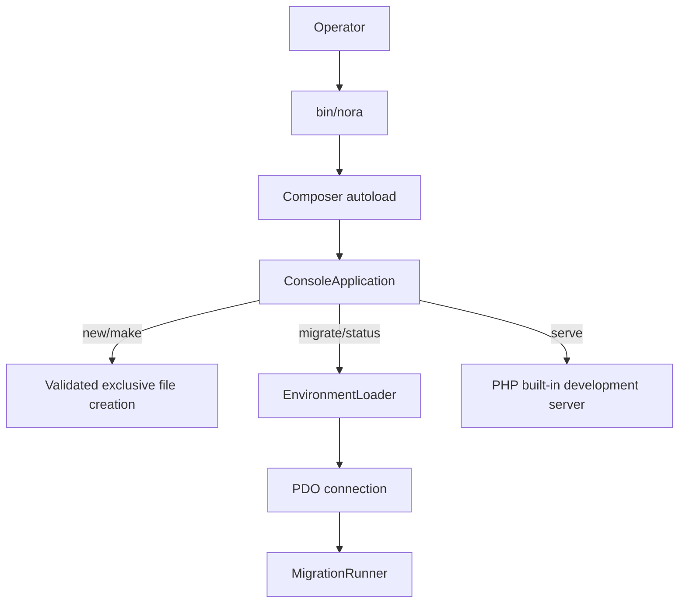

# CLI Architecture

`bin/nora` loads Composer autoloading and dispatches arguments to
`ConsoleApplication`. Commands are implemented in that class and return a
process exit code.

Implemented commands:

- `--help`, `--version`
- `new <name>`: creates a new project only if the destination does not exist;
  generated Composer metadata uses a local path repository to the creating
  Nora checkout.
- `make:controller <name>` and `make:model <name>`: validate class names and
  exclusively create files under fixed source directories.
- `migrate` and `migrate:status`: load `.env`, require `NORA_DSN`, connect via
  PDO, and run/report migrations. Database availability is required.
- `serve [host] [port]`: starts PHP's built-in development server for a
  generated application. Host must be an IP and port must be in range.

There are no advertised placeholder commands. The built-in web server is not
for production. Scaffolds are tied to the local path of the Nora checkout
until the package is published or otherwise distributed.

