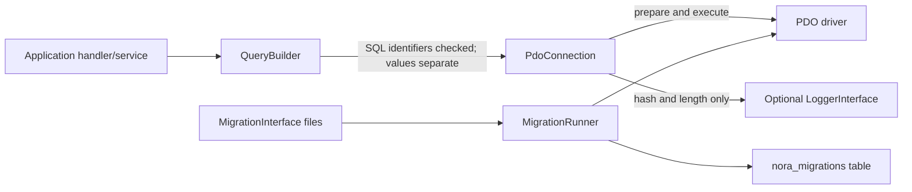
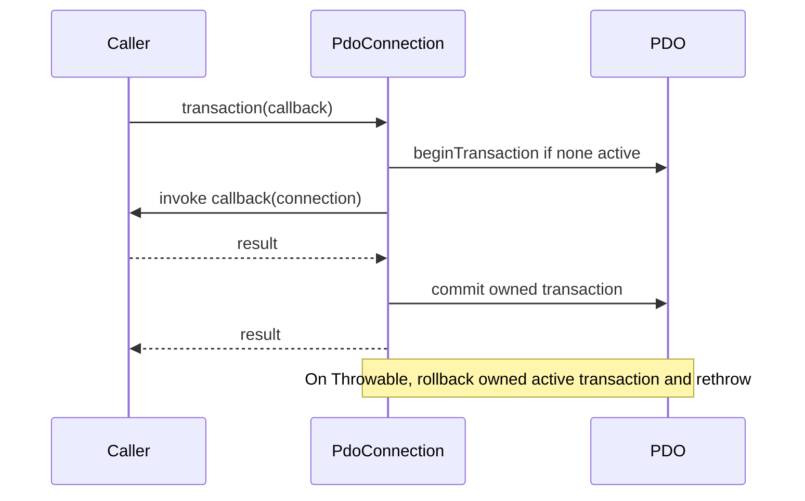

# Database Architecture

## Implemented access path

`PdoConnection` configures exception mode, associative fetches, and native
prepares. `QueryBuilder` currently builds SELECT queries; table/column names
must match a conservative identifier grammar and operators are allowlisted.
Raw SQL remains a trusted caller responsibility. Bound values are never
included in logs.

Transactions commit on success and roll back on thrown failures when the
connection wrapper owns the transaction. Migrations are named
`YYYY_description.php` and return a `MigrationInterface`. The runner tracks
applied names and batches in `nora_migrations`.

MySQL DDL commonly auto-commits. The migration runner avoids claiming that a
MySQL DDL migration is atomic; a failure can leave schema changes without a
history record. Real MySQL/MariaDB behavior has not been tested because no
local service was available. Migration tests use a PDO test double.

Only MySQL/MariaDB is the supported baseline. Other drivers have not been
operationally validated.

## Transaction lifecycle

Nested calls do not create savepoints: only the call that starts the transaction
commits or rolls it back. MySQL DDL may auto-commit and is not made atomic by
this helper.
