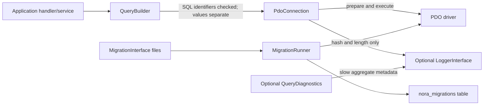

# Database Architecture

## Implemented access path



`PdoConnection` configures exception mode, associative fetches, and native
prepares. `QueryBuilder` builds SELECT, INSERT, UPDATE, and DELETE statements;
table/column names must match a conservative identifier grammar and comparison
operators are allowlisted. UPDATE and DELETE require a `where()` predicate.
Mutation values are bound before predicate values in deterministic order.
`PdoConnection::executeBuilder()` returns PDO's driver-dependent affected-row
count. Raw SQL remains a trusted caller responsibility. Bound values are never
included in logs. The builder does not support joins or arbitrary SQL
expressions.

Transactions commit on success and roll back on thrown failures when the
connection wrapper owns the transaction. Nested calls use SQL savepoints; a
nested failure rolls back to its savepoint and propagates the original
exception, allowing the outer callback to catch it and continue only when the
rollback succeeds. If rollback fails, the rollback failure's exception class
is logged and the outer transaction is prevented from committing. When a
transaction was opened directly on the PDO instance, Nora uses a savepoint
rather than taking ownership of the outer transaction. Migrations are named
`YYYY_description.php` and return a `MigrationInterface`. The runner tracks
applied names and batches in `nora_migrations`.

MySQL DDL commonly auto-commits. The migration runner avoids claiming that a
MySQL DDL migration is atomic; a failure can leave schema changes without a
history record. A failed migration remains pending in status because no
applied-history row is recorded. Before retrying, inspect the schema and the
migration's completed effects, then reconcile manually; the runner does not
attempt automatic schema rollback. Unit migration tests use a PDO test double;
the live MySQL integration tests are configured below but were not executed in
this local environment because no server is available.

The framework uses PDO's MySQL driver (`pdo_mysql`). CI configures a disposable
MySQL 8.4 service; the integration tests require a database explicitly named
`nora_test` or `nora_test_<suffix>` and matching `NORA_TEST_DB_NAME`. Hosted CI
results are not established by the repository configuration alone. MariaDB
and other PDO drivers have not been independently validated and should be
treated as unverified.

The live integration suite creates uniquely named fixture tables and removes
only those tables and its uniquely named migration history rows. It never
connects anywhere except loopback (`127.0.0.1`, `localhost`, or `::1`), and
never drops a database. CI sets `NORA_REQUIRE_TEST_DB=1`, which makes a missing
database configuration fail rather than skip. Local runs may omit that flag
and will report a skipped database test when no DSN is configured. The test
user needs only the privileges needed for `SELECT`, `INSERT`, `DELETE`,
`CREATE`, and `DROP` in the dedicated test database. CI creates a separate
non-root account with only those grants using
`.github/mysql-init/01-nora-test-user.sql`.

## Transaction lifecycle

```mermaid
sequenceDiagram
    participant Caller
    participant Connection as PdoConnection
    participant PDO
    Caller->>Connection: transaction(callback)
    Connection->>PDO: beginTransaction if none active, otherwise SAVEPOINT
    Connection->>Caller: invoke callback(connection)
    Caller-->>Connection: result
    Connection->>PDO: commit transaction or RELEASE SAVEPOINT
    Connection-->>Caller: result
    Note over Connection,PDO: On Throwable, roll back transaction or to savepoint; never commit after rollback failure
```

`PdoConnection` supports nested savepoints on database drivers that implement
SQL savepoints. MySQL DDL may implicitly commit the transaction and invalidate
savepoints; the helper cannot make schema changes atomic or guarantee rollback
after such DDL.
