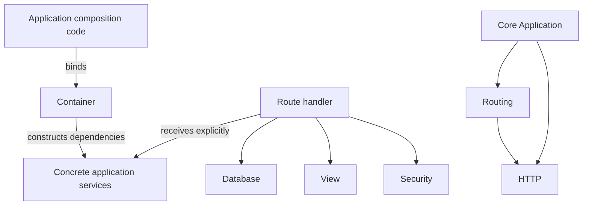

# Dependency Rules

## Current rules

- `Http` must not depend on routing, application, or container code.
- `Routing` may use HTTP request and response types but must not access the
  database or resolve services by user-controlled class name.
- `Core\Application` orchestrates request handling; it does not contain
  business logic.
- The container is an explicit composition tool. Classes should receive
  dependencies through constructors rather than repeatedly querying a global
  service locator.
- Database, template, and security modules are available to application
  handlers/services. They must not be dependencies of the router.
- AI modules do not exist; their dependency direction must be documented before
  implementation.
- Dependencies flow inward to contracts and lower-level primitives. Circular
  module dependencies are prohibited.

The current container supports explicit bindings and auto-resolution of a
requested concrete class. Applications must not pass untrusted input as a
service identifier.
