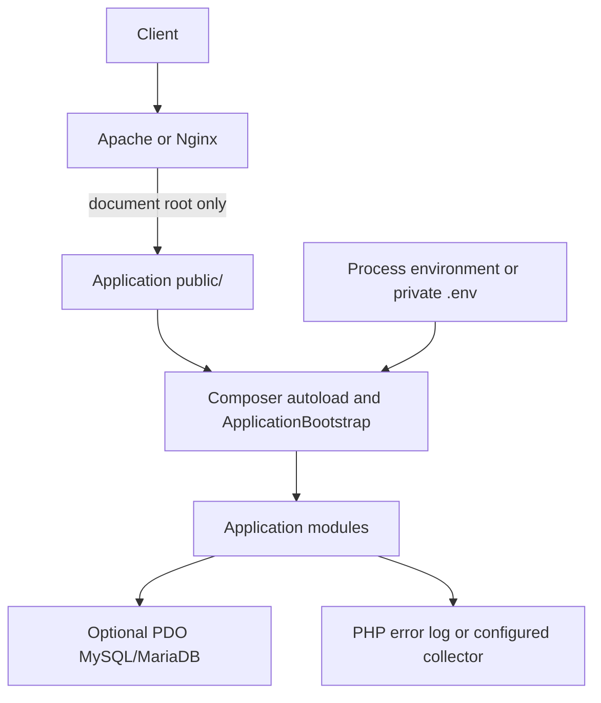

# Deployment Architecture

## Current deployment status

Linux, Apache, and Nginx deployment has not been exercised. The generated
application places only its entry point and router under `public/`; source,
Composer metadata, environment files, and migration files remain above that
document root.

For production, configure the web server document root to `public/`, use a
supported PHP-FPM/Apache PHP runtime, keep `.env` and source outside the
document root, set `APP_DEBUG=false`, restrict write permissions, and provision
database credentials through the process environment or a secret manager.

The `nora serve` command starts PHP's development server only. No Apache/Nginx
configuration, health endpoint, backup automation, rollback orchestration, or
deployment pipeline has been verified. Treat those as deployment work, not
framework features.
