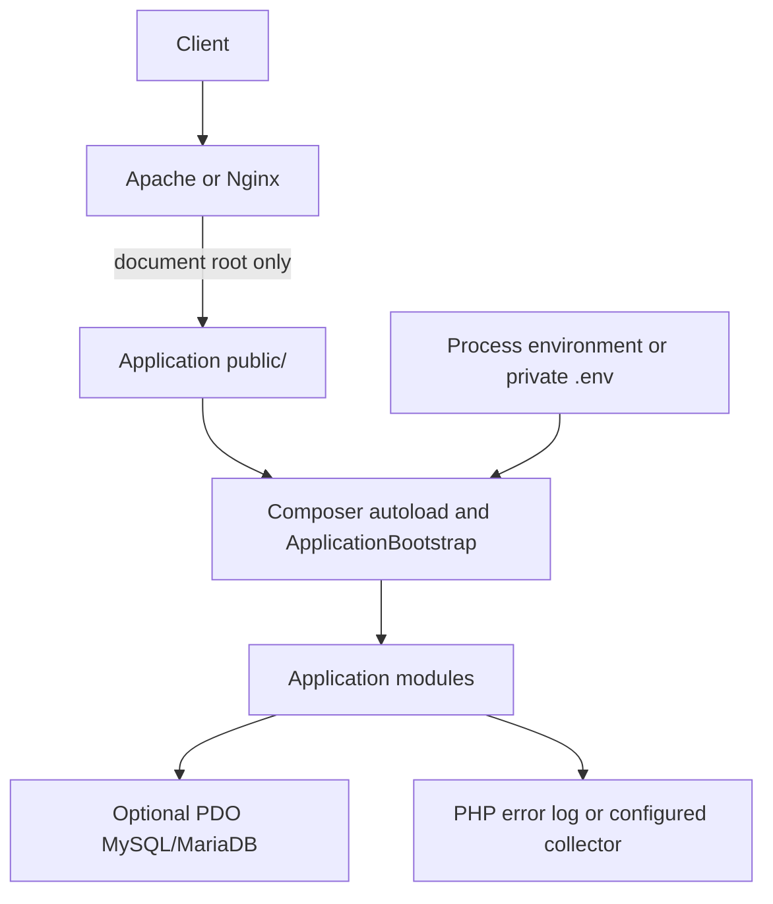

# Deployment Architecture

## Current deployment status

Linux, Apache, and Nginx deployment has not been exercised. The generated
application places only its entry point and router under `public/`; source,
Composer metadata, environment files, and migration files remain above that
document root.



For production, configure the web server document root to `public/`, use a
supported PHP-FPM/Apache PHP runtime, keep `.env` and source outside the
document root, set `APP_DEBUG=false`, restrict write permissions, and provision
database credentials through the process environment or a secret manager.

Set request-body size limits at the reverse proxy or web server as well as in
PHP. This upstream limit is the earliest enforceable boundary because the
request reaches the server before Nora's PHP code runs. For example, an Nginx
server can use:

```nginx
client_max_body_size 1m;
```

For Apache, configure the public application directory or virtual host with an
appropriate `LimitRequestBody 1048576` directive. Align these limits with PHP's
`post_max_size` and Nora's `Request::fromGlobals()` default of 1 MiB. Verify the
effective settings for the deployed SAPI and proxy chain; framework checks do
not prevent an upstream server or PHP runtime from receiving or buffering
bytes first. Nora does not currently implement multipart upload handling.

The `nora serve` command starts PHP's development server only. No Apache/Nginx
configuration, health endpoint, backup automation, rollback orchestration, or
deployment pipeline has been verified. Treat those as deployment work, not
framework features.
