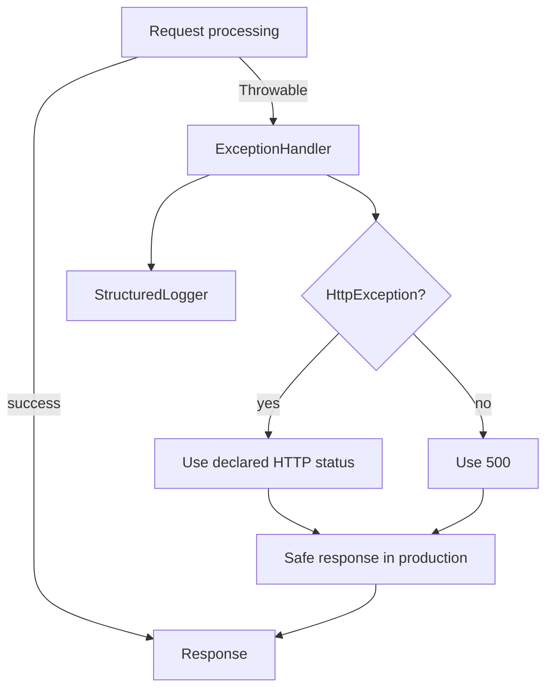

# Error Handling and Logging

`Application::handle()` catches request-pipeline `Throwable` values and passes
them to `ExceptionHandler`. `HttpException` maps to its declared 4xx/5xx code;
unknown exceptions map to 500. In production, a generic response is returned.
Debug details are opt-in through `ApplicationBootstrap` configuration.

`StructuredLogger` writes one JSON record per line with UTC timestamp, level,
message, and context. It redacts context fields whose names indicate secrets,
scrubs common inline credential patterns, and omits objects/resources. Database
logs include a SQL hash and length, never parameter values.

The minimum level is configurable with `logging.level` or `NORA_LOG_LEVEL`;
accepted levels are `debug`, `info`, `notice`, `warning`, `error`, and
`critical`.

The logger does not implement rotation; deployment must configure an external
log collector or rotation policy. Logger write failures throw and are not
silently ignored. Request identifiers and trace correlation are not yet
implemented.

