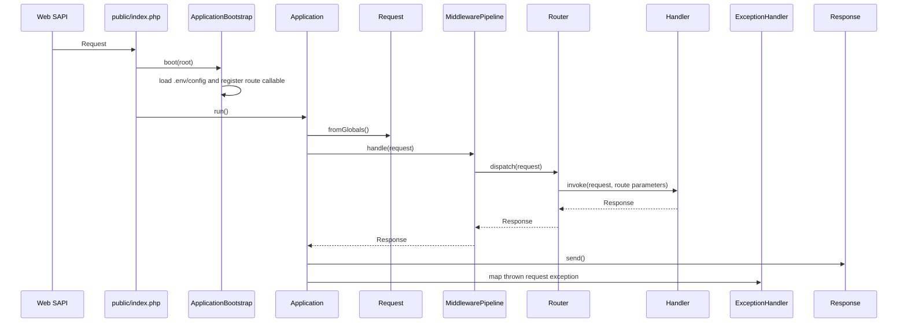
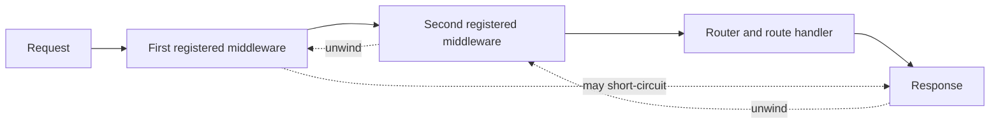
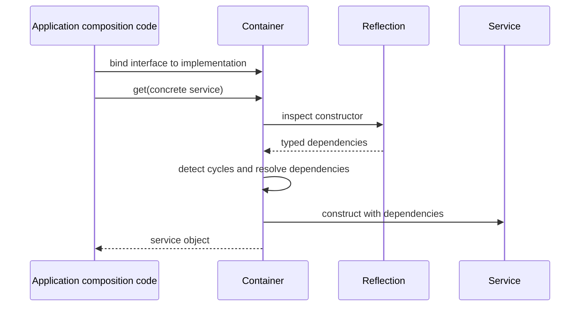

# Request Lifecycle

## Web entry point



`Application::handle(Request)` is the non-SAPI test seam. Middleware registration
order is outer-to-inner for request processing and reversed for response
unwinding. A middleware may return a response without calling downstream.
Exceptions thrown by request processing are sent to `ExceptionHandler`.
Exceptions while constructing the bootstrap are surfaced to the caller.

## Middleware execution



The current pipeline is global to an `Application` instance; route-specific
middleware and groups are not implemented.

## Reactive action lifecycle (prototype)

```mermaid
sequenceDiagram
    participant Browser
    participant Runtime as Delegated browser runtime
    participant App as Application route
    participant Session as SessionMiddleware
    participant Engine as ReactiveEngine
    participant Action as Explicit ReactiveAction
    participant Component as ReactiveComponent

    Browser->>App: GET mounted page
    App->>Session: start session
    Session->>Engine: render initial page and CSRF token
    Engine->>Component: initial state + render
    Engine-->>Browser: full SSR HTML and runtime asset
    Browser->>Runtime: click data-nora-action control
    Runtime->>App: POST JSON action + args + revision + CSRF
    App->>Session: start same session
    Session->>Engine: dispatch action request
    Engine->>Engine: verify payload, page ownership, CSRF, revision
    Engine->>Action: validate arguments and authorize
    Action-->>Engine: next server state
    Engine->>Component: render current page state
    Engine->>Session: persist state and next revision
    Engine-->>Runtime: JSON HTML update
    Runtime->>Browser: reconcile keyed nodes; retain compatible DOM
```

Reactive routes are opt-in. Installing a `ReactiveEngine` prepends its session
middleware and adds fixed runtime/action routes, ensuring previously
registered session-dependent middleware runs after the session starts. Each
page state is stored in that session; action requests cannot submit replacement
state or choose a PHP method. A revision mismatch returns current HTML with
HTTP 409, without reapplying the action. The first implementation re-renders
the component page after each successful server action; it does not reload the
document.

## Container resolution



The container is independently usable; `ApplicationBootstrap` does not
silently turn it into a global service locator.
