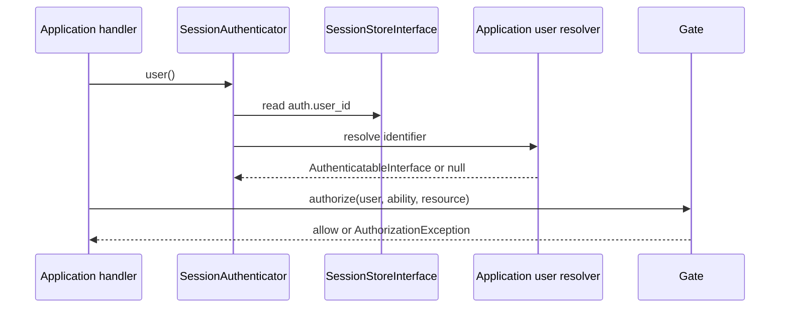

# Security Architecture

## Scope and caveat

Security controls are applied at component boundaries and have regression
tests. They have not been independently reviewed; passing tests is not a
security certification.

## Implemented protections

- SQL query values are passed separately to PDO prepared statements.
  `QueryBuilder` validates identifiers and comparison operators.
- Response headers reject invalid names and CR/LF values.
- Production exception responses do not disclose exception messages or stack
  traces. Logs include exception class and status, not the raw exception
  message.
- Structured logs redact sensitive context keys and credential-like text and
  omit arbitrary objects/resources.
- Session settings enable strict mode, cookies only, no trans-SID, HTTP-only,
  SameSite=Lax, and secure cookies by default.
- `SessionMiddleware` starts the session before downstream middleware and
  closes it on response/exception unwind.
- Session-backed login/logout rotates the identifier.
- Authentication transitions invalidate the session CSRF token.
- Authorization denies undefined abilities.
- CSRF middleware checks unsafe HTTP methods with a session token using
  `hash_equals`; it is opt-in and should be attached to browser/session routes.
- Template variable interpolation is HTML-escaped. Templates are plain text
  and PHP is not evaluated.
- CLI project names and class names are constrained; file creation is
  exclusive and refuses overwrite.

## Trust boundaries and limitations

| Boundary | Implemented | Remaining risk/work |
|---|---|---|
| HTTP input | Request method/path checks, JSON/form parsing | No size limits, multipart uploads, general schema policy |
| Database | PDO prepared values and safe query-builder identifiers | Raw SQL remains caller-authored; live MySQL not tested |
| Session | Secure cookie defaults and ID rotation | No session expiry policy, store backend, or deployment proxy policy |
| Authentication | User identifier contract and session resolver integration | No account provider, credential flow, remember-me, brute-force limiter |
| Authorization | Explicit Gate abilities, deny-by-default | Applications must define and enforce every resource policy |
| CSRF | Opt-in unsafe-method middleware | Stateless API distinction is application configuration; no origin policy |
| Rendering | Escaped values and root-confined includes | Only HTML text interpolation is escaped; JS/CSS/URL contexts are not specialized |
| CLI | Allowlisted names and exclusive file creation | Local operators still control the executable and project directory |
| AI tools | Not implemented | Must use explicit schema, authorization, least privilege, resource limits, audit |
| Reactive actions | Explicit action registry, strict JSON schema and request limits, CSRF/origin checks, session-bound opaque page, expected revision, deny-by-default per-action authorization | No durable exactly-once semantics or account provider; actions without a callback are denied; intentionally public actions require `ReactiveAction::publicAction`; component HTML remains trusted PHP |

No protection is provided against brute force, rate exhaustion, unsafe file
uploads, SSRF, command execution, unsafe deserialization, or insecure
deployment permissions. Do not expose the development server publicly.

Reactive page state is stored in PHP session data and is not serialized to the
browser. The browser submits an opaque random page handle, action identifier,
argument object, expected revision, and CSRF token. The engine resolves the
page only within the current session, validates the action allowlist and
arguments, calls the action's authorization callback (absence denies), checks
the revision, and only then invokes the transition and persists a returned
JSON-safe state. Intentionally public actions use `ReactiveAction::publicAction`;
their permission extends to any holder of a valid page/session handle. Stale
requests do not repeat actions. The session lock serializes requests only
within the relevant PHP session; it does not provide durable transaction or
exactly-once behavior for external side effects.

The reactive document serves its script from the same origin and sets a
restrictive script policy. Its response is not cacheable. Reactive components
are trusted PHP code: `render()` returns HTML, so dynamic user data must be
escaped with `TemplateRenderer` or equivalent contextual encoding. The
browser parses server-rendered fragments to reconcile nodes; this is not a
sanitizer for unsafe developer-authored markup. A developer must not emit
untrusted HTML, event-handler attributes, or executable content.

The protocol has request, state, and rendered-output size limits. It does not
yet implement upload handling, distributed idempotency keys, persistent
connections, per-child state ownership, offline retries, or a formal browser
support matrix. Production apps must use HTTPS and secure session cookies.

## Authentication and authorization flow

Authentication integration does not itself enforce authorization; the
application must call `Gate` at each protected operation.
