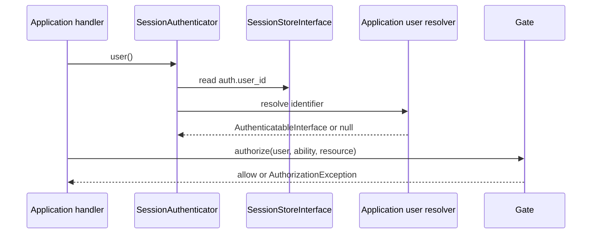

# Security Architecture

## Scope and caveat

Security controls are applied at component boundaries and have regression
tests. They have not been independently reviewed; passing tests is not a
security certification.

## Implemented protections

- SQL query values are passed separately to PDO prepared statements.
  `QueryBuilder` validates identifiers and comparison operators.
- Response headers reject invalid names and CR/LF values.
- Production exception responses do not disclose exception messages or stack
  traces. Logs include exception class and status, not the raw exception
  message.
- Structured logs redact sensitive context keys and credential-like text and
  omit arbitrary objects/resources.
- Session settings enable strict mode, cookies only, no trans-SID, HTTP-only,
  SameSite=Lax, and secure cookies by default.
- `SessionMiddleware` starts the session before downstream middleware and
  closes it on response/exception unwind.
- Session-backed login/logout rotates the identifier.
- Authentication transitions invalidate the session CSRF token.
- Authorization denies undefined abilities.
- CSRF middleware checks unsafe HTTP methods with a session token using
  `hash_equals`; it is opt-in and should be attached to browser/session routes.
- The opt-in fixed-window rate limiter uses a file-backed store with hashed
  keys, a directory-wide exclusive lock, and atomic state-file replacement.
  Storage failures fail closed with a generic 503 response.
- Upload validation uses PHP upload status, bounded sizes, actual file-content
  MIME detection, and a configured extension/MIME allowlist. The local private
  store uses random identifiers and does not use client filenames as paths.
- `Request::fromGlobals()` reads the body incrementally with a 1 MiB default
  cap, rejects oversized declared lengths before reading, and rejects malformed
  or inconsistent `Content-Length` values.
- Template variable interpolation is HTML-escaped. Templates are plain text
  and PHP is not evaluated.
- CLI project names and class names are constrained; file creation is
  exclusive and refuses overwrite.

## Trust boundaries and limitations

| Boundary | Implemented | Remaining risk/work |
|---|---|---|
| HTTP input | Request method/path checks, JSON/form parsing, bounded `Request::fromGlobals()` body reads, access to PHP-parsed multipart upload fields | Upstream size limits are required before PHP; directly constructed requests are caller-supplied; general schema policy remains application-owned |
| Database | PDO prepared values and safe query-builder identifiers | Raw SQL remains caller-authored; live MySQL not tested |
| Session | Secure cookie defaults and ID rotation | No session expiry policy, store backend, or deployment proxy policy |
| Authentication | User identifier contract and session resolver integration | No account provider, credential flow, remember-me, brute-force limiter |
| Authorization | Explicit Gate abilities, deny-by-default | Applications must define and enforce every resource policy |
| CSRF | Opt-in unsafe-method middleware; reactive endpoints also check origin/fetch metadata | Stateless API policy is application configuration |
| Rate limiting | Opt-in fixed-window `RateLimitMiddleware`; application supplies the bucket key; file updates are locked and hashed | Single-host/local filesystem only unless shared locking is verified; not a volumetric DoS control; storage errors return 503 |
| Uploads | `Request::file()` / `files()`, PHP upload status checks, per-file and aggregate byte limits, fileinfo MIME allowlist, random-ID private filesystem storage, and an opt-in authorization gate before private reads | No malware scan, quota/retention scheduler, metadata repository, streaming response, or cloud backend; application must persist metadata, authorize access, configure ACLs, and integrate large-file streaming |
| Rendering | Escaped values and root-confined includes | Only HTML text interpolation is escaped; JS/CSS/URL contexts are not specialized |
| CLI | Allowlisted names and exclusive file creation | Local operators still control the executable and project directory |
| AI tools | Not implemented | Must use explicit schema, authorization, least privilege, resource limits, audit |
| Reactive actions | Explicit action registry, strict JSON schema and request limits, CSRF/origin checks, session-bound page and child identities, expected page revision, independent child state, deny-by-default per-action authorization | No durable exactly-once semantics or account provider; actions without a callback are denied; intentionally public actions require `ReactiveAction::publicAction`; component HTML remains trusted PHP |

No automatic protection is provided against brute force, unsafe file uploads,
SSRF, command execution, unsafe deserialization, or insecure deployment
permissions. Rate limiting is opt-in and depends on the application's chosen
key and policy. Do not expose the development server publicly.

`FileRateLimitStore` hashes keys before filenames or state are written, and
uses an exclusive lock shared by all buckets in its configured directory.
The directory must be dedicated, private, and outside the public document
root. Unix-like systems receive owner-only permission requests; Windows
deployments must set appropriate filesystem ACLs. The backend is suitable for
a single host. A shared filesystem is supported only when its `flock`
semantics have been verified; Nora makes no distributed-consistency claim.
Expired buckets are removed only by an explicit `cleanup()` call. Middleware
fails closed with a generic 503 if storage cannot be read or updated. This
application-level control does not replace limits at the reverse proxy, web
server, network, or operating-system resource boundary.

The upload API ignores client MIME metadata and checks file content with PHP's
`fileinfo` extension against an explicit extension/MIME allowlist. Client
filenames are not used in storage paths. When `DOCUMENT_ROOT` is available,
the local adapter refuses a resolved storage directory inside it. The
application must persist trusted file metadata and use
`AuthorizedPrivateFileReader` (or equivalent authorization) before opening
each file. Framework file-byte limits do not include multipart framing;
configure matching `Request::fromGlobals()` and PHP limits plus an upstream
request cap. `Response` currently buffers bodies, so applications need a
streaming integration for large downloads. No malware scanning, quota,
retention scheduler, or cloud storage is provided.

Reactive page state is stored in PHP session data and is not serialized to the
browser. The browser submits an opaque random page handle, action identifier,
argument object, expected revision, and CSRF token. The engine resolves the
page only within the current session, validates the action allowlist and
arguments, calls the action's authorization callback (absence denies), checks
the revision, and only then invokes the transition and persists a returned
JSON-safe state. Nested component identities are generated by the server and
resolved only from the current page's session-owned child map. Child props are
validated against the registered child component's declared rules. Child
state is stored independently from parent and sibling state; the client may
select a child identity but cannot supply or overwrite its state. A page-level
revision check serializes state changes across that component tree, while
authorization is evaluated against the selected component's current state
and validated arguments. Removed children are disposed and cannot be reused.
Intentionally public actions use `ReactiveAction::publicAction`;
their permission extends to any holder of a valid page/session handle. Stale
requests do not repeat actions. The session lock serializes requests only
within the relevant PHP session; it does not provide durable transaction or
exactly-once behavior for external side effects.

The reactive document serves its script from the same origin and sets a
restrictive script policy. Its response is not cacheable. Reactive components
are trusted PHP code: `render()` returns trusted markup, and neither Nora nor
the browser automatically sanitizes it. Dynamic user data must be escaped with
`TemplateRenderer` or equivalent contextual encoding. The browser parses
server-rendered fragments to reconcile nodes; this is not a sanitizer for
unsafe developer-authored markup. A developer must not emit untrusted HTML,
event-handler attributes, or executable content.

`Request::fromGlobals()` enforces a default 1 MiB limit while reading
`php://input`, and the reactive protocol applies its separate 16 KiB limit
after request construction. This is not the earliest request boundary: a
reverse proxy or web server may receive or buffer the body before PHP runs.
Production deployments must also set a request-body limit at that upstream
layer, aligned with the framework limit. Direct `Request` construction and
`Request::fromUri()` accept caller-provided bodies and do not apply the global
ingress limit.

The protocol has request, state, child-count, and rendered-output size limits.
It does not implement upload handling, distributed idempotency keys,
persistent connections, offline retries, or a formal browser support matrix.
Production apps must use HTTPS and secure session cookies.

## Authentication and authorization flow

Authentication integration does not itself enforce authorization; the
application must call `Gate` at each protected operation.
