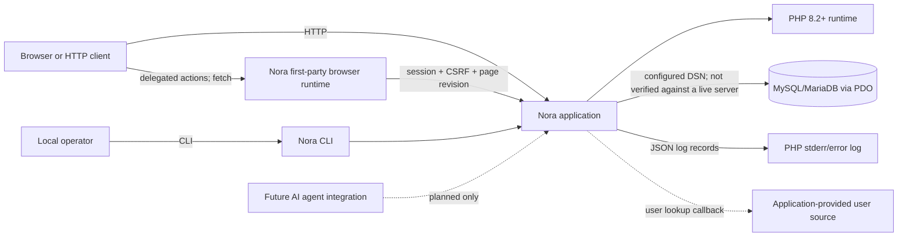
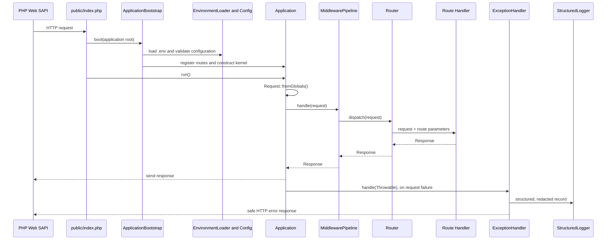
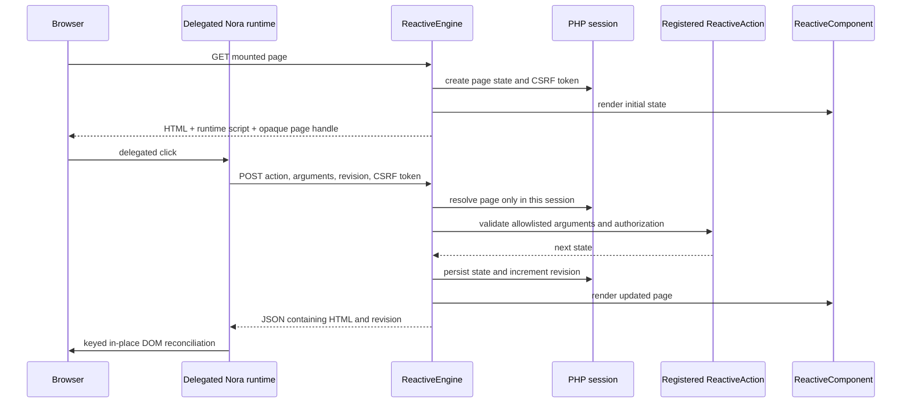
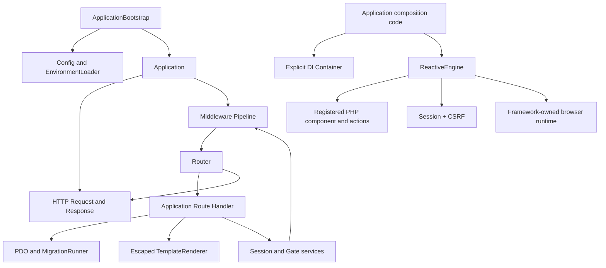

# Nora System Overview

## Project identity and independence

Nora is created in Morocco by Morave Technologies, which is the project origin
and maintainer. It is an independently implemented PHP framework core, not a
distribution or wrapper around Laravel or Symfony. Its runtime currently has
no third-party Composer package dependency; Composer, PHP standards, and
compatible ecosystem packages may be used where they provide clear value.
This project does not claim to be the first Moroccan PHP framework; the
[scoped comparison](../docs/PROJECT_POSITIONING.md) explains the evidence and
limits of that assessment.

## Status

This is an early modular-monolith PHP framework with a prototype
server-rendered reactive UI path. The diagrams describe current behavior;
planned capabilities are labeled. MySQL/MariaDB server integration has not
yet been verified in this environment.

## System context

The user provider is an application callback, not an included user database or
authentication service. AI integration is not implemented.

## Application bootstrap and HTTP request

`Application` orchestrates rather than containing application business logic.
Routes execute in registration order; literal routes must precede overlapping
parameterized routes. `Request::fromGlobals()` reads PHP server data and the
request body. `Application::handle()` is usable without SAPI globals for tests.

## Reactive page and action

The reactive engine is opt-in. Generated starter apps register it for their
page route. A mounted page is rendered into HTML and stored in the user's PHP
session with a random page handle and monotonic revision. The page includes
one document-level event runtime and a session CSRF token. Browser interactions
submit only a named allowlisted action, validated arguments, and expected
revision. The server applies the registered transition and re-renders from
authoritative session state; a keyed in-place reconciliation updates the
document without navigating or initializing per-component islands.

The initial example contains two adjacent counter components sharing one
page-state count. Independent nested component ownership/lifecycle is not
implemented. See the [Reactive UI Engine specification](REACTIVE_UI_ENGINE.md).

## Module relationships

The container is explicit, not a global singleton. Database access does not
belong in the router. Security, database, and view modules remain usable
independently of the request kernel.

## Implemented boundaries

- `Http`: immutable request/response data and SAPI conversion.
- `Routing`: route matching and deterministic middleware execution.
- `Core`: bootstrap, application orchestration, HTTP exception mapping.
- `Config`: layered configuration and non-interpolating environment parsing.
- `Container`: explicit service bindings and constructor resolution.
- `Database`: PDO wrapper, prepared-value queries, allowlisted SELECT builder,
  transaction helper, and migration tracking.
- `Security`: native session wrapper, authentication integration contracts,
  password helper, Gate, CSRF token manager/middleware.
- `View`: plain-text templates with escaped interpolation and bounded includes.
- `Validation`: nested field rules and custom validation contract.
- `Logging`: JSON-lines records with redaction/omission.
- `Console`: functional scaffold, generators, migration commands, and dev server.
- `Reactive`: opt-in SSR page components, explicit validated actions,
  session-owned state, CSRF/revision checks, and one delegated browser runtime.

Independent child-state coordination, reactive forms, navigation, durable
mutation idempotency, and real-time transport are not implemented. Optional
AI runtime, provider adapters, agent tools, job queues, ORM, and production
web-server configuration are also not implemented.
